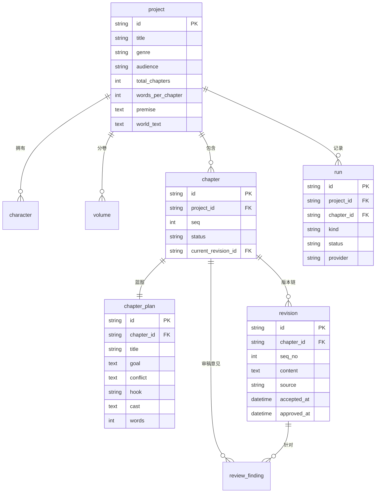
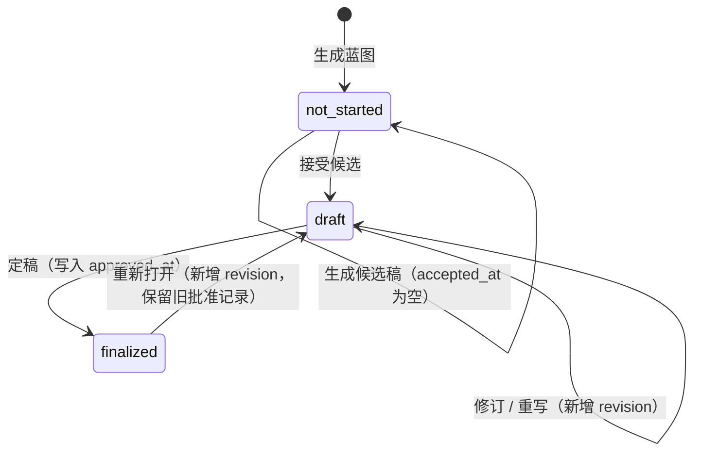

# 概念数据模型

状态：M0 草案（随 demo 验证）
配套：[术语表](../product/glossary.md) · [ADR 0001](../decisions/0001-host-form-and-ui-architecture.md)

## 一、设计目标

1. **三个维度互不覆盖**：创作状态、存储版本、内容来源分别落在不同字段，不合并成单一枚举。
2. **版本不可变**：`revision` 一旦写入不再修改，修订产生新行。
3. **草稿与定稿共享同一条历史链**：定稿不是另起一份文件，而是某条 revision 被批准。
4. **可迁移**：demo 用 SQLite，字段类型与约束按 PostgreSQL 设计，M1 换库不改模型。

## 二、实体关系

## 三、实体定义

### 3.1 project（作品）

| 字段 | 类型 | 约束 | 说明 |
|---|---|---|---|
| `id` | String(36) | PK | UUID |
| `title` | String(200) | NOT NULL | 作品名 |
| `genre` | String(60) | | 类型 |
| `audience` | String(60) | | 目标读者 |
| `language` | String(10) | NOT NULL，默认 `zh` | 写作语言 |
| `total_chapters` | Integer | NOT NULL，默认 0 | 计划总章数 |
| `words_per_chapter` | Integer | NOT NULL，默认 3000 | 每章目标字数 |
| `premise` | Text | | 一句话前提 |
| `world_text` | Text | | 世界观正文 |
| `created_at` / `updated_at` | DateTime | NOT NULL | UTC |

### 3.2 character（角色）

| 字段 | 类型 | 约束 | 说明 |
|---|---|---|---|
| `id` | String(36) | PK | |
| `project_id` | String(36) | FK → project，索引 | |
| `name` | String(120) | NOT NULL | |
| `level` | String(4) | 默认 `L2` | `L1`/`L2`/`L3`/`L4`，决定填写深度 |
| `function` | String(200) | | 在故事中的功能（大纲阶段产出） |
| `desire` | Text | | Want |
| `flaw` | Text | | Lie / Wound 摘要 |
| `arc_note` | Text | | 弧线节点 |
| `status_note` | Text | | 当前状态（动态权威，随章更新） |

### 3.3 volume（卷）

| 字段 | 类型 | 约束 | 说明 |
|---|---|---|---|
| `id` | String(36) | PK | |
| `project_id` | String(36) | FK，索引 | |
| `seq` | Integer | NOT NULL | 卷序，从 1 开始 |
| `name` | String(120) | | |
| `core_function` | String(120) | | 引入/建立/深化/转折/收束 |
| `end_state` | Text | | 「谁做了什么选择 → 导致什么结果」 |

唯一约束：`(project_id, seq)`。

### 3.4 chapter（章）与 chapter_plan（章节蓝图）

`chapter` 承载**状态**，`chapter_plan` 承载**规划内容**，一对一。

| chapter 字段 | 类型 | 约束 | 说明 |
|---|---|---|---|
| `id` | String(36) | PK | |
| `project_id` | String(36) | FK，索引 | |
| `seq` | Integer | NOT NULL | 章号，从 1 开始 |
| `status` | String(16) | NOT NULL，默认 `not_started` | 见状态机 |
| `current_revision_id` | String(36) | FK → revision，可空 | 当前生效版本 |

唯一约束：`(project_id, seq)`。

| chapter_plan 字段 | 类型 | 约束 | 说明 |
|---|---|---|---|
| `id` | String(36) | PK | |
| `chapter_id` | String(36) | FK，UNIQUE | 一章一蓝图 |
| `title` | String(200) | | |
| `goal` | Text | | 主角本章小目标 |
| `conflict` | Text | | 冲突与转折 |
| `hook` | String(200) | | 悬念/章末钩子 |
| `cast` | Text | | 出场人物（逗号分隔） |
| `words` | Integer | | 目标字数 |

> 建蓝图时同步建 `chapter`（`status = not_started`），保证「有蓝图即有章」。

### 3.5 revision（版本）

**唯一不可变表**。任何内容变更都新增一行。

| 字段 | 类型 | 约束 | 说明 |
|---|---|---|---|
| `id` | String(36) | PK | |
| `chapter_id` | String(36) | FK，索引 | |
| `seq_no` | Integer | NOT NULL | 本章内递增，从 1 开始 |
| `content` | Text | NOT NULL | 正文 Markdown |
| `source` | String(10) | NOT NULL | `ai` / `human` / `import` |
| `accepted_at` | DateTime | 可空 | 人接受候选的时刻；空 = 仍是候选稿 |
| `approved_at` | DateTime | 可空 | 定稿批准的时刻；空 = 非定稿 |
| `created_at` | DateTime | NOT NULL | |

唯一约束：`(chapter_id, seq_no)`。

**三维映射**：

| 维度 | 落在哪 |
|---|---|
| 创作状态 | `chapter.status` |
| 存储版本 | `revision` 的行（每行一次快照） |
| 内容来源 | `revision.source` + `accepted_at` |

一条 `source='ai'` 且 `accepted_at IS NULL` 的 revision，就是术语表里的**候选稿**。人被接受后写 `accepted_at`，它成为草稿的当前版本。定稿时写 `approved_at`。三者互不替代。

### 3.6 review_finding（审稿意见）

| 字段 | 类型 | 约束 | 说明 |
|---|---|---|---|
| `id` | String(36) | PK | |
| `chapter_id` | String(36) | FK，索引 | |
| `revision_id` | String(36) | FK，索引 | 针对哪一版提出 |
| `round` | Integer | 默认 1 | 对应 06 的四轮 |
| `severity` | String(8) | NOT NULL | `block` / `warn` / `hint` |
| `category` | String(20) | | `structure` / `fact` / `reading` / `rules` |
| `text` | Text | NOT NULL | 意见内容 |
| `status` | String(10) | NOT NULL，默认 `pending` | `pending` / `accepted` / `rejected` |

### 3.7 run（运行）

| 字段 | 类型 | 约束 | 说明 |
|---|---|---|---|
| `id` | String(36) | PK | |
| `project_id` | String(36) | FK，索引 | |
| `chapter_id` | String(36) | FK，可空 | 章节类运行才有 |
| `kind` | String(24) | NOT NULL | `plan_generation` / `draft_generation` / `review` |
| `status` | String(10) | NOT NULL | `running` / `succeeded` / `failed` / `cancelled` |
| `provider` | String(40) | NOT NULL | 如 `mock` / `hermes` |
| `model` | String(80) | | |
| `started_at` / `finished_at` | DateTime | | |
| `output_summary` | Text | | 产物摘要，便于运行侧页展示 |
| `error` | Text | | 失败原因 |

## 四、章节状态机

规则：

1. **候选不改变状态**。生成 AI 稿件后章节仍是 `not_started`，直到人接受。
2. **定稿必须有人**。`finalized` 的章必须存在 `approved_at` 非空的 revision。
3. **重新打开需显式动作**，且必须说明原因；旧批准记录保留，不删除。
4. **状态只能由领域服务写**，Agent 与自动化无权限。

## 五、不变量（用于自动化校验）

| 编号 | 不变量 |
|---|---|
| I1 | `chapter.current_revision_id` 必须指向本章的 revision，可空但不可跨章 |
| I2 | `finalized` 的章至少有一条 `approved_at` 非空的 revision |
| I3 | 同一 `chapter_id` 下 `seq_no` 连续无空洞 |
| I4 | `revision` 行一旦写入，`content`/`source`/`created_at` 不可更新 |
| I5 | `review_finding.revision_id` 必须属于同一 `chapter_id` |
| I6 | 删除 `chapter` 前必须先删除其 revision 与 finding（或整体软删） |

## 六、索引

| 表 | 索引 | 用途 |
|---|---|---|
| `chapter` | `(project_id, seq)` UNIQUE | 章序唯一 |
| `chapter` | `(project_id, status)` | 按状态筛选 |
| `revision` | `(chapter_id, seq_no)` UNIQUE | 版本链 |
| `revision` | `(chapter_id, accepted_at)` | 找候选稿 |
| `review_finding` | `(chapter_id, status)` | 待处理意见 |
| `run` | `(project_id, started_at DESC)` | 运行列表 |

## 七、SQLite → PostgreSQL 迁移

| 项 | demo（SQLite） | M1（PostgreSQL） |
|---|---|---|
| 主键 | `String(36)` UUID 文本 | `uuid` 类型，默认 `gen_random_uuid()` |
| 时间 | `DateTime`（naive，UTC 存储） | `timestamptz` |
| 文本 | `TEXT` | `text` |
| 布尔 | `Boolean` | `boolean` |
| JSON | `Text` 存 JSON | `jsonb`（若启用） |
| 自增序 | 应用层计算 `max(seq_no)+1` | 同样应用层，事务内加锁 |
| 外键约束 | 需 `PRAGMA foreign_keys=ON` | 原生支持 |

迁移原则：**模型层不改，只换方言**。所有字段名、约束、索引名保持一致。

## 八、与文件形态的映射

| 文件（skill） | 表 |
|---|---|
| `brief.md` | `project`（设定字段） |
| `outline.md`（骨架） | `volume` + `chapter_plan` |
| `world.md` | `project.world_text`（demo 简化，M1 拆 `world_entry`） |
| `tracking/characters/*.md` | `character` |
| `tracking/progress.md` | `chapter` 状态 + `review_finding` 摘要 |
| `content/chXX-draft.md` | `revision`（`accepted_at` 非空、`approved_at` 空） |
| `content/chXX.md` | 同一 revision（`approved_at` 非空） |

> demo 不落文件，全部进库。M1 再引入 Markdown 双向同步（另立 ADR）。

## 九、待定

1. `world` 是否拆为独立实体（当前塞在 `project.world_text`，长作品会撑不住）。
2. `chapter_plan` 是否支持多版本（改蓝图要不要留历史）。
3. 候选稿是否落文件（影响审计与恢复，M3 前定）。
4. `run` 是否需要记录 token 与成本（M7 预算控制依赖它）。
